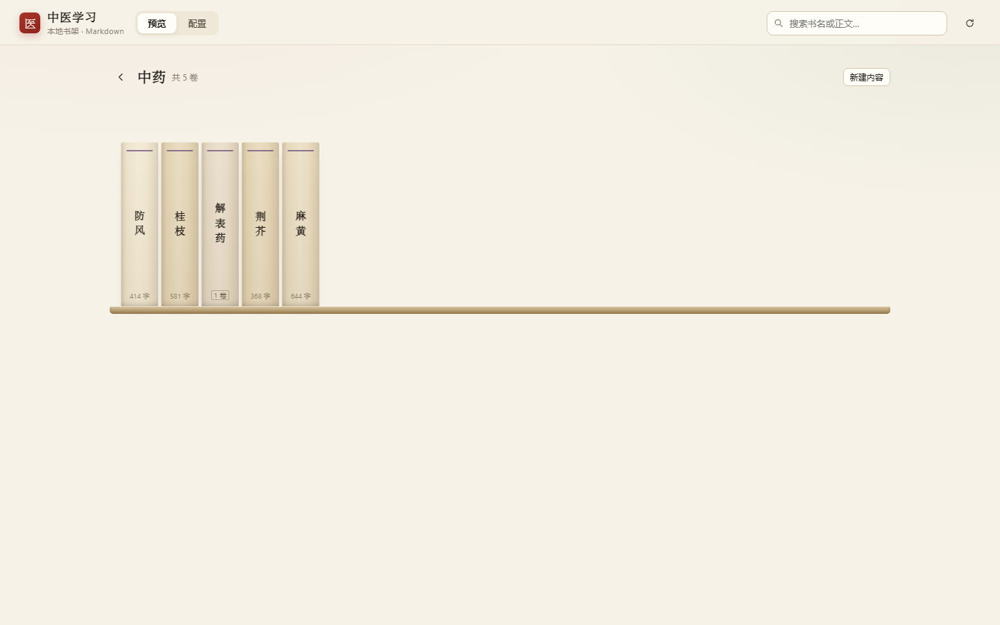
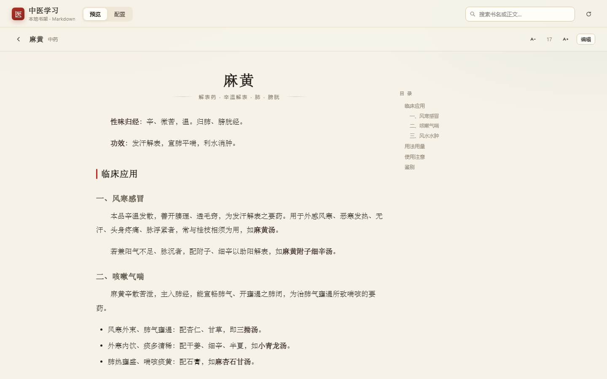
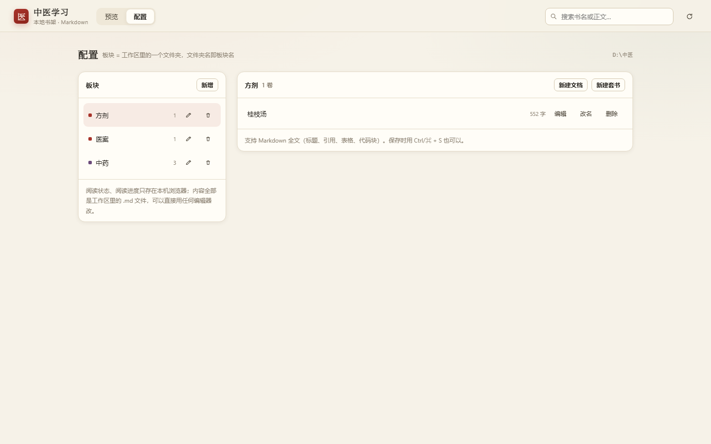

# 中医学习 · DSH 插件

> 在 [DeepSeek Harness](https://github.com/deepseek-ai/deepseek-harness) 的 Web GUI 里，用工作区的 Markdown 搭一座中医书架：板块 → 书脊 → 阅读，另有一页配置后台。



## 功能

- **侧栏入口**：导航栏（工作区列表上方）一行「中医学习」，点开占据整页，和官方「插件」页同级。
- **板块 = 文件夹**：工作区里每个文件夹自动成为一个板块，文件夹名即板块名，无需登记。
- **书架**：书脊站立、等高，悬停 Dock 式放大（纯 `transform`，不重排）；每层按可用宽度放满，层板固定最长宽度。
- **阅读**：衬线排版、右侧目录与滚动高亮、字号调节、上一卷/下一卷、阅读进度。
- **配置**：板块/文档增删改、Markdown 源码 + 实时预览、`Ctrl/⌘+S` 保存、删除进回收站。
- **全文搜索**：标题 + 正文，最多 40 条。
- **纯本地**：所有内容都是工作区里的 `.md`，不联网、无遥测，模型也看不到。

| 阅读 | 配置 |
|---|---|
|  |  |

## 安装

要求 DSH 0.2.x（Web GUI 带 `sidebar.panellist` / `main` slot 的版本）。

### 从 GitHub 安装（推荐）

```bash
dsh plugin add https://github.com/lsh-lenvast/dsh-plugin-tcm-learning
```

插件在 `package.json` 里声明了 `dsh.bundle.patch`，安装时会自动挂载，不必手改配置。装完刷新页面即可看到侧栏入口。

### 手动安装（本地开发 / 没有 CLI 时）

1. 让 profile 能找到这个包（软链或目录联接）：

   ```powershell
   # Windows
   New-Item -ItemType Junction `
     -Path "$env:USERPROFILE\.dsh\profiles\desktop\node_modules\dsh-plugin-tcm-learning" `
     -Target "D:\path\to\dsh-plugin-tcm-learning"
   ```

   ```bash
   # macOS / Linux
   ln -s /path/to/dsh-plugin-tcm-learning ~/.dsh/profiles/desktop/node_modules/dsh-plugin-tcm-learning
   ```

2. 在 profile 的 `cordis.patch.yml` 末尾追加：

   ```yaml
   - insert:
       - id: tcm-learning
         name: dsh-plugin-tcm-learning
   ```

3. 开着 HMR 会自动热载；否则重启 DSH。

## 使用

1. 在 DSH 里打开一个工作区（这个工作区就是数据根，插件只读写它）。
2. 点侧栏「中医学习」。
3. 首次进入会自动扫描根目录下的文件夹作为板块；没有板块就在「配置」里新建一个。
4. 想加内容：在配置页新建，或者**直接把 `.md` 丢进对应文件夹**再点右上角刷新。

### 数据布局

```
<工作区>\
├── .tcm\
│   ├── config.json        # 板块显示信息（标题/颜色/排序/隐藏）
│   └── trash\             # 删除的内容，可手动找回
├── 中药\
│   ├── 麻黄.md            # 一个 .md = 一卷
│   └── 解表药\            # 文件夹 = 套书（内含多卷）
│       └── 01-辛温解表药.md
├── 医案\太阳中风案.md
└── 方剂\桂枝汤.md
```

Markdown 支持 frontmatter：`title`、`tags`、`summary`；没有 `title` 时用文件名。

## 开发

```bash
pnpm install
pnpm build      # -> lib/index.js (Host) + lib/client.js (浏览器半)

# 离线冒烟：客户端 slot 注册 + 全部 HTTP API + 路径安全
node test/smoke.mjs "D:\path\to\workspace"

# 用真实数据生成预览夹具，再直接打开 test/preview.html 看三种视图
node test/preview.mjs "D:\path\to\workspace"
```

`lib/` 是构建产物，**也提交进仓库**：这样从 GitHub 直接安装时不需要现场编译。

### 实现要点

- **双半结构**：Node 半只提供 `/tcm/api/*`（读写工作区 Markdown、路径收口、回收站、`mtime` 乐观锁）；浏览器半只做界面。客户端 bundle 由 esbuild 打成 DSH 的模块外壳，`react` 走外壳自带的静态模块表，不新增运行时依赖。
- **两处 slot**：`sidebar.panellist`（侧栏入口）+ `main` keyed slot（整页面板），与官方「插件」页同一个机制。
- **动画只动 `transform` / `opacity`**：书脊布局尺寸固定，放大靠 `scale`，邻居位移用 `translateX` 补偿，文字反向 `scale` 抵消；悬停投影用 `::after` 的透明度过渡。改样式时别退回 `width`/`height` 动画，否则每帧都会重排。

## 已知限制

- 数据根是「已登记工作区列表的第一个」，可在顶栏下拉切换；不跟随当前会话的工作目录。
- 书脊还没有拖拽排序；板块「隐藏」字段已在数据模型里，UI 未暴露。
- 没有做 Agent 工具（让模型直接写入某个板块）。

## 许可

[MIT](LICENSE)
